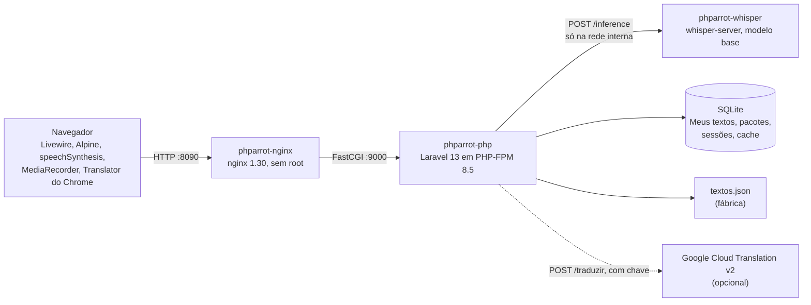

# Arquitetura

Um app Laravel servido por nginx e PHP-FPM, com a transcrição num container à parte. Tudo sobe pelo Terraform, com o provider Docker, numa rede interna (`phparrot-network`).



## Peças

| Peça | Papel |
|---|---|
| Navegador | Monta as telas com Livewire e Alpine. Lê em voz alta com `speechSynthesis`, grava com `MediaRecorder` e compara a transcrição com a frase (`resources/js/comparacao.js`). No modo "Apenas Chrome", traduz com a `Translator` do navegador. |
| `phparrot-nginx` | Única porta publicada (8090). Serve `public/` e repassa o resto ao PHP-FPM. O `/transcrever` aceita até 3 MB de corpo. |
| `phparrot-php` | Laravel 13 com Livewire 4. Rotas `POST /transcrever` e `POST /traduzir` com limite por IP e teto diário, a gestão atrás do token e o catálogo de textos. |
| `phparrot-whisper` | `whisper-server` do whisper.cpp v1.9.5, compilado do fonte com commit conferido e um patch revisado. Sem porta no host, `/tmp` em memória e sem log. |
| SQLite | Meus textos, pacotes importados (e qual está ativo), sessões e cache (inclusive a trava da transcrição e os pacotes já lidos). |
| `textos.json` | A fábrica: o pacote que vem com o app, só leitura. Vale quando nenhum pacote importado está ativo. |
| Google Cloud Translation | Opcional, só com `GOOGLE_TRANSLATE_KEY`. Usada quando o visitante escolhe "Google API". |

Os textos chegam ao app pelo contrato `Catalogo`, que soma o pacote ativo e os Meus textos. A transcrição passa pelo contrato `Transcritor`, e a tradução pelo `Tradutor`. Trocar o motor é escrever outra implementação.

## Pacotes e temas

Um pacote é um JSON no formato 2:

```json
{
  "formato": 2,
  "pacote": { "slug": "comida-2026", "nome": "Comida", "versao": "2026.10.1", "idiomas": ["en", "pt-BR"] },
  "itens": [
    { "id": "comida-n1-f01", "tema": "comida", "nivel": 1, "tipo": "frase", "en": "I want some rice.", "pt-BR": "Eu quero arroz." }
  ]
}
```

- **Temas:** dez slugs fixos (`rotina-casa`, `comida`, `compras`, `transporte-viagem`, `trabalho`, `saude`, `lazer`, `familia-amigos`, `tecnologia`, `cidade-servicos`), com o nome no `lang/`.
- **Ativo:** um pacote por vez. O catálogo é o pacote ativo somado aos Meus textos, e os `idiomas` do pacote são os idiomas ativos. O pacote lido fica em cache pelo `hash` do conteúdo.
- **Validador:** `php artisan textos:validar {arquivo}` confere estrutura, ids, idiomas, texto proibido (`<`, `>`, controle, endereço da web) e as faixas de palavras por nível do [anexo](../.ai/adr/0011-anexo-niveis.md). O mesmo validador serve o importador.
- **Visitante:** o select "Tema" da Leitura, da Fala e da Escuta lista só os temas com itens no nível. "Todos" é o padrão.
- **Transição:** a fábrica de hoje traz os 150 itens antigos sem tema. A semente por tema para os autores fica em `resources/data/rascunhos/`, fora do app.

## Fluxo da Fala

1. **Ouvir:** o navegador lê a frase com a voz do idioma treinado. A frase começa escondida, e o olho a revela.
2. **Gravar:** o `MediaRecorder` grava até 30 s, e o áudio fica só no navegador até o visitante pedir a transcrição.
3. **Transcrever:**
   - O áudio vai a `POST /transcrever`, com o idioma treinado.
   - O Laravel valida tipo, tamanho (até 2 MB) e idioma, e pega a trava (uma transcrição por vez).
   - Depois envia o áudio ao `whisper-server` com o idioma e a duração máxima.
   - O arquivo temporário é apagado num `finally`, e nada vai para log ou banco.
   - Se a trava não vier em 5 s, a resposta é 503 com `Retry-After`.
4. **Comparar:**
   - O navegador normaliza os dois textos: caixa, pontuação, apóstrofos e números de 0 a 100 por extenso.
   - Depois alinha as palavras por distância de edição e marca cada uma como certa, trocada, faltando ou extra.

A Escuta usa o mesmo bloco de gravação, com o texto escondido até a transcrição.

## Decisões

- [0001 Stack](../.ai/adr/0001-stack.md) e [0002 Ambiente](../.ai/adr/0002-ambiente.md)
- [0003 Formato do textos.json](../.ai/adr/0003-textos-json.md), trocado em parte pelo [0011 Temas e pacotes](../.ai/adr/0011-temas-e-pacotes.md)
- [0004 Voz e transcrição](../.ai/adr/0004-voz-e-transcricao.md) e [0007 Transcrição](../.ai/adr/0007-transcricao.md)
- [0005 Visual](../.ai/adr/0005-visual.md)
- [0006 Tradução](../.ai/adr/0006-traducao.md)
- [0008 Gestão de textos](../.ai/adr/0008-gestao.md)
- [0009 CI de containers](../.ai/adr/0009-ci-containers.md) e [0010 Dependências](../.ai/adr/0010-dependencias.md)
- [0012 Tradução do conteúdo](../.ai/adr/0012-traducao-de-conteudo.md) (planejado)
